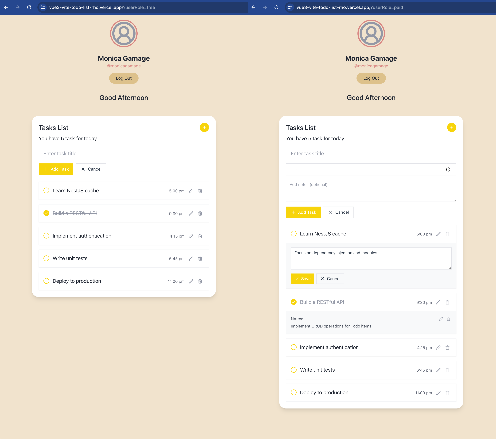

# To-Do-List

<div align="center">

</div>

Vue 3 frontend for [`nest-todo-list-api`](../nest-todo-list-api). The API owns auth,
per-user data, quotas and rate limiting; this app talks to it over HTTP.

## Prerequisites

- **Node.js 22.12+ or 24+** — pinned in `.nvmrc`, so `nvm use` picks it up. Vite 7,
  Vitest 5 and jsdom 30 all refuse to run on Node 20.
- **pnpm** — the lockfile is `pnpm-lock.yaml`. Do not use npm.
- **The API running.** From the API repo: `docker compose up -d --scale api=3`.
  It is served through nginx at `http://localhost:3000/api/v1`, and its
  `CORS_ORIGINS` already allows `http://localhost:5173`.
- **Chrome, Edge or Firefox for development.** The refresh-token cookie is
  `Secure`, and Safari refuses `Secure` cookies over plain `http`, including on
  localhost — login appears to work and then every refresh fails.

## Setup

```sh
nvm use
pnpm install
cp .env.example .env     # VITE_API_URL, defaults to the value the API uses
pnpm dev
```

## Scripts

| command | what it does |
|---|---|
| `pnpm dev` | dev server with HMR on port 5173 |
| `pnpm build` | type-check, then build to `dist/` |
| `pnpm preview` | serve the production build |
| `pnpm type-check` | `vue-tsc --build` across the app, node and vitest projects |
| `pnpm lint` | ESLint flat config, with `--fix` |
| `pnpm format` | Prettier over `src/` |
| `pnpm test` | Vitest in watch mode |
| `pnpm test:run` | Vitest once |
| `pnpm test:coverage` | Vitest with v8 coverage |

## Built using

Vue 3 (`<script setup>`) · Vite 7 · TypeScript · Pinia · Vue Router ·
TanStack Query *(planned)* · Tailwind CSS 4 + shadcn-vue · Axios · Vitest

## Recommended IDE setup

[VS Code](https://code.visualstudio.com/) +
[Vue (Official)](https://marketplace.visualstudio.com/items?itemName=Vue.volar).
The old `TypeScript Vue Plugin (Volar)` extension is deprecated and should be
uninstalled — the Vue extension handles `.vue` type information on its own.

`tsc` cannot type-check `.vue` files, which is why `type-check` uses `vue-tsc`.
